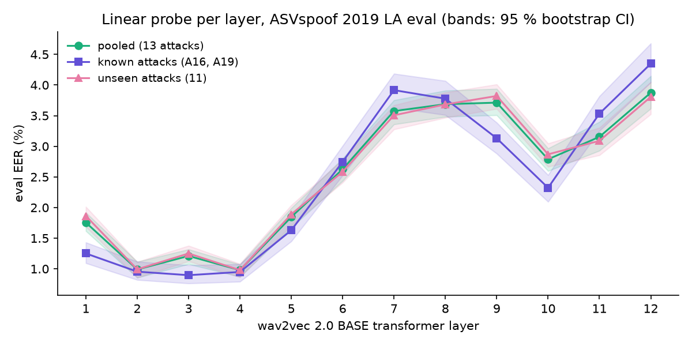

# audio-deepfake-generalization


Real or synthetic voice? I compare classical features (LFCC) with a frozen
self-supervised model (wav2vec 2.0) on ASVspoof 2019 LA, and look at what
happens on generators the detectors never saw during training.

Three questions drive the project:

1. **Unseen attacks.** 11 of the 13 eval attacks are generators absent from training.
   How much does each approach lose on them?
2. **Shortcuts.** ASVspoof 2019 is known to leak the label through leading and trailing
   silence. Are my detectors listening to the voice, or to the silence?
3. **Telephone channel.** Voice fraud happens over the phone. What is left of the
   detection after 8 kHz resampling, G.711, Opus and packet loss?

## Status

Work in progress. Every number below was measured with the scripts in this repo;
nothing is copied from papers except the official reference, which is cited.

### Milestone 1: LFCC + GMM baseline

| | EER (%) | 95 % CI | min t-DCF |
|---|---|---|---|
| my LFCC + GMM, B02 settings | 10.48 | [10.16, 10.78] | 0.279 |
| official B02 (Todisco et al., 2019) | 8.09 | | 0.212 |

I did not manage to reproduce the official baseline within the ±1.5 point margin I
had set myself: I am 2.4 points above. Fixing the four settings that differed from
the published description changed almost nothing (10.52 % before, 10.48 % after),
and I stopped there rather than keep tuning on the eval set. The details, what I
checked and what is still unknown are in [docs/M1_baseline.md](docs/M1_baseline.md).


One result I did not expect: the two "known" attacks (A16, A19, same algorithms as
two training attacks) are harder for this baseline than the 11 unseen ones,
16.1 % against 9.0 % EER.

### Milestone 2: which wav2vec 2.0 layer hears the fake?

One logistic regression per layer of a frozen wav2vec 2.0 BASE, on the mean and std of
that layer over time. The layer is picked on dev (training attacks only), never on eval.



| | pooled EER (%) | 95 % CI | unseen attacks EER (%) | min t-DCF |
|---|---|---|---|---|
| LFCC + GMM (M1) | 10.48 | [10.16, 10.78] | 9.02 | 0.279 |
| wav2vec 2.0 layer 3 + linear probe | 1.21 | [1.08, 1.32] | 1.25 | 0.037 |

The early layers (2 to 4) carry most of the information; the last layer is about four
times worse. I am suspicious of how good this looks: the pooling includes silence, and
ASVspoof 2019 is known to leak the label through silence length. Milestone 4 checks that.
Details in [docs/M2_probes.md](docs/M2_probes.md).

### Milestone 3: four systems, and real-world deepfakes

Same training data for all (ASVspoof 2019 LA, attacks A01–A06), selection on dev only.
Then a second test set the systems never saw in any form: In-the-Wild, 31,779 real and
fake recordings of public figures found online.


| System | Runs | eval EER (%) | unseen attacks EER (%) | In-the-Wild EER (%) |
|---|---|---|---|---|
| LFCC + GMM | 1 | 10.48 | 9.02 | 36.72 |
| LFCC + LCNN | 3 seeds | 5.63 ± 0.68 | 6.20 ± 0.75 | 71.94 ± 5.21 |
| wav2vec 2.0 + linear probe (layer 3) | 1 | **1.21** | **1.25** | **22.44** |
| wav2vec 2.0 + MLP (weighted layers) | 3 seeds | 1.64 ± 0.20 | 1.75 ± 0.24 | 26.18 ± 0.24 |

What I take from it:

- **Out of domain, everything falls apart.** The best system goes from 1.2 % to 22.4 %. A
  low EER on ASVspoof says little about a real phone call or a video found online.
- **The LCNN is worse than chance on In-the-Wild** (71.9 %): its ranking is inverted. I
  checked it is not a bug. At a threshold of 0 it accepts 98 % of real ASVspoof voices but
  only 4 % of real In-the-Wild voices. My guess, to be tested in M4 and M5: it learned
  "real = clean studio speech".
- **The simplest wav2vec 2.0 model generalises best.** The MLP is better on dev and worse
  everywhere else than a logistic regression on one layer.
- **Thresholds do not transfer.** Even the probe, at a threshold of 0, rejects 97 % of real
  In-the-Wild voices. A deployment would need its own calibration data.

Intervals, min t-DCF, per-attack results and the Kaggle mishaps on the way are in
[docs/M3_comparison.md](docs/M3_comparison.md).

| Milestone | Content | State |
|---|---|---|
| M0 | Foundations: metrics, protocols, tests, CI | done |
| M1 | LFCC + GMM baseline, reproduce the official EER | done, official EER not reproduced (see above) |
| M2 | wav2vec 2.0 layer-wise probing | done |
| M3 | Full comparison, 3 seeds, In-the-Wild | done |
| M4 | Silence shortcut and frequency-band analysis | |
| M5 | Telephone-channel robustness | |
| M6 | Raspberry Pi 5 inference (optional) | |

## Running the tests

```bash
pip install -r requirements-ci.txt
pytest -v
```

## Data

See [docs/DATA.md](docs/DATA.md) for sources, licences and attribution. No audio is
stored in this repository.

## License

Code: MIT. Datasets keep their own licences (see docs/DATA.md).
