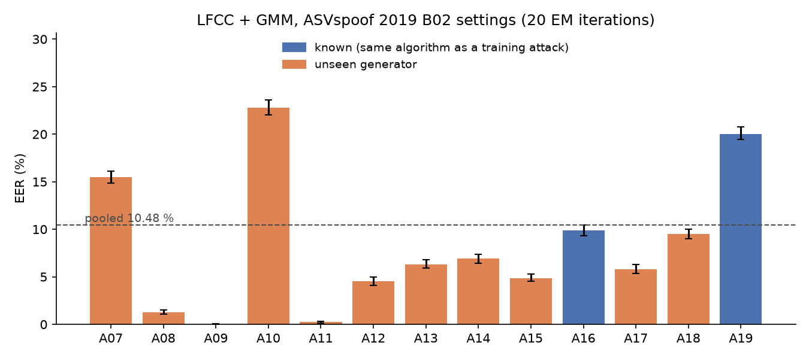

# Milestone 1: LFCC + GMM baseline

## What I wanted

Before comparing anything, I wanted to reproduce the official ASVspoof 2019 LA
baseline B02 (LFCC features, two 512-component GMMs). If my pipeline lands on the
published number, I can trust it for the rest of the project. The target from my
spec was the official EER within ±1.5 points.

Official B02 on the LA eval set (Todisco et al., Interspeech 2019, Table 1):
**EER 8.09 %, min t-DCF 0.2116.**

## What I got

Two runs, both on the full eval set (7,355 bona fide, 63,882 spoofed trials).
Intervals are 95 % percentile bootstrap, 1000 resamples, bona fide and spoof
resampled separately. Seed 0 for the GMM initialisation.

| Run | LFCC settings | EM iterations | EER (%) | 95 % CI | min t-DCF |
|---|---|---|---|---|---|
| first run | torchaudio defaults: Hann window, 0–8 kHz, log(E + 1e-6) | 10 | 10.52 | [10.20, 10.88] | 0.290 |
| B02 settings | Hamming window, 30 Hz–8 kHz, log floor 2.2e-16 | 20 | 10.48 | [10.16, 10.78] | 0.279 |
| official B02 | | | 8.09 | | 0.212 |

**The ±1.5 point target is not met.** I am 2.4 points above the published EER.

After the first run, I compared my settings with the published description of B02
and found three documented differences (window, lower band edge, number of EM
iterations) plus a likely fourth (the log floor). I changed all four in one go and
ran once more. The result barely moved. I stopped there on purpose: trying more
settings while watching the eval EER would be tuning on the test set, and the
numbers would stop meaning anything.

## Is the evaluation itself wrong?

I checked what I could:

- protocol counts match the evaluation plan exactly for train, dev and eval, and
  speakers are disjoint across partitions;
- EER and min t-DCF are unit-tested against hand-computed cases and against an
  independent brute-force EER;
- the ASV operating point taken from the organisers' ASV scores gives
  Pfa = Pmiss = 2.46 %, which is what an EER threshold should produce.

So I believe the metrics. The gap is in the front-end or the GMM training.

## Remaining differences I cannot rule out

The original baseline is MATLAB code that I could not inspect directly. What is
still unknown:

- **delta computation**: I use torchaudio's regression over ±2 frames; the
  original may use a different width;
- **GMM training**: I initialise with k-means++ on 200k frames then run EM on all
  frames; the original toolkit may split components progressively, which can
  land in a different local optimum;
- **framing details**: I use a centred STFT with reflect padding at the edges.

One independent data point: a reproduction study (FairSSD supplementary
material, CVPR workshops 2024) reports that a scikit-learn port of the same
baseline gives clearly different numbers from the MATLAB code. Ports of this
baseline not matching the original seems to be a known issue, not something
specific to my code.

## What the per-attack breakdown shows



The surprise is on the "known" attacks. A16 and A19 reuse the algorithms of A04 and
A06, which the GMM saw in training, yet they are among the hardest: A19 is at 20.0 %,
and the known group as a whole (16.1 %) is worse than the unseen group (9.0 %).
Having seen a generator during training does not guarantee anything here. A19/A06
is a voice-conversion system whose output stays close to the source spectrum,
which is a plausible reason for LFCCs to struggle, but I have not verified that yet.

On the unseen side, A10 (22.8 %) and A07 (15.5 %) are the hard ones, while A09 and
A11 are almost perfectly detected (below 0.3 %).

## Cost on my laptop (Ryzen 3 7320U, 4 cores, 7.3 GB RAM)

B02 run, measured with `time.perf_counter`, single run:

| Stage | Time |
|---|---|
| LFCC train (25,380 files, 3 worker processes) | 8.3 min |
| LFCC eval (71,237 files, 3 worker processes) | 21.5 min |
| GMM bona fide (875,610 frames, 20 EM iterations) | 7.2 min |
| GMM spoof (7,832,272 frames, 20 EM iterations) | 37.3 min |
| Scoring eval | 5.1 min |

## Reproducing

```bash
python scripts/download_asvspoof2019.py --out data
python scripts/run_lfcc_gmm.py --preset asvspoof2019_b02 --em-iter 20
python scripts/run_lfcc_gmm.py --preset first_run --em-iter 10
python scripts/plot_per_attack.py results/lfcc_gmm_asvspoof2019_b02/metrics_eval.csv results/lfcc_gmm_asvspoof2019_b02/eer_per_attack.png
```

Scores, GMM parameters and run metadata for both runs are in `results/`.
