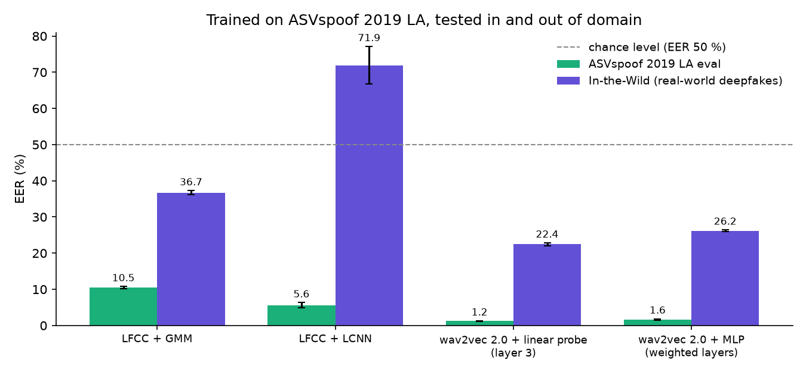
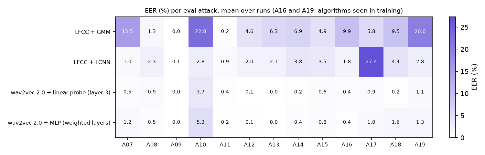

# Milestone 3: four systems, in and out of domain

## What is compared

All four are trained on ASVspoof 2019 LA train (attacks A01–A06) and selected on dev
(same attacks). Nothing is tuned on eval or on In-the-Wild.

| System | Features | Classifier | Runs | Where it ran |
|---|---|---|---|---|
| LFCC + GMM | 60-dim LFCC (B02 settings) | two 512-component GMMs | 1 | laptop (milestone 1) |
| LFCC + LCNN | same LFCC, 4 s crops | Light CNN, 173,777 parameters | 3 seeds | Kaggle T4, ~67 s per epoch |
| wav2vec 2.0 + linear probe | layer 3, mean + std over time | logistic regression | 1 (deterministic) | laptop (milestone 2) |
| wav2vec 2.0 + MLP | all 12 layers, learned softmax weights | MLP, 393,741 parameters | 3 seeds | laptop, ~10 s per epoch |

Test sets:

- **ASVspoof 2019 LA eval**: 7,355 bona fide, 63,882 spoofed, 13 attacks of which 11 never
  seen in training;
- **In-the-Wild** (Müller et al., 2022): 31,779 recordings found online, 19,963 real and
  11,816 deepfakes (counted from the metadata), of 58 public figures according to the
  dataset page. Different speakers, recording conditions and
  generators. Nothing from it is used for training or selection.

Each run gets a 95 % bootstrap interval (1000 resamples). For the 3-seed systems the table
gives mean ± standard deviation over seeds; per-seed intervals are in
`results/m3/per_run.csv`.

## Results



| System | Runs | eval EER (%) | unseen attacks EER (%) | In-the-Wild EER (%) | eval min t-DCF |
|---|---|---|---|---|---|
| LFCC + GMM | 1 | 10.48 [10.16, 10.78] | 9.02 [8.71, 9.33] | 36.72 [36.14, 37.29] | 0.279 |
| LFCC + LCNN | 3 | 5.63 ± 0.68 | 6.20 ± 0.75 | 71.94 ± 5.21 | 0.141 ± 0.024 |
| wav2vec 2.0 + linear probe (layer 3) | 1 | **1.21** [1.08, 1.32] | **1.25** [1.13, 1.38] | **22.44** [21.94, 22.85] | **0.037** |
| wav2vec 2.0 + MLP (weighted layers) | 3 | 1.64 ± 0.20 | 1.75 ± 0.24 | 26.18 ± 0.24 | 0.048 ± 0.006 |

### 1. On ASVspoof, pre-trained features win clearly

The LCNN halves the GMM's EER (5.6 % against 10.5 %), and both wav2vec 2.0 systems are
another three to four times lower. The gap between LFCC and wav2vec 2.0 is far larger than
the seed-to-seed variation.

### 2. More capacity does not mean better generalisation

The MLP has more parameters and sees all 12 layers, yet it is worse than a logistic
regression on one layer, on eval (1.64 against 1.21 %) and on In-the-Wild (26.2 against
22.4 %). On dev it was better (0.08–0.20 % against 0.15 %). My reading: the extra capacity
goes into fitting the six training attacks more closely, which does not transfer. The
learned layer weights (all three seeds) still put the most weight on layers 2–4, the same
layers the probes of milestone 2 singled out.

### 3. In-the-Wild breaks everything, the LCNN worst of all

Out of domain, every system loses a lot: the probe goes from 1.2 % to 22.4 % (about ×18).
That is the real message of this milestone. An EER of 1 % on ASVspoof says little about
what happens on a phone call or a video found online.

The LCNN is a special case. 71.9 % EER is **worse than chance**: on In-the-Wild its
ranking is inverted. I checked this is not a bug before believing it:

- the same code, same score orientation, gives 5.2 % on ASVspoof eval (seed 0);
- on the same In-the-Wild labels, the GMM (36.7 %) and the probe (22.4 %) stay below 50 %;
- with a threshold at 0, seed 0 accepts 98 % of real ASVspoof voices but only **4 % of
  real In-the-Wild voices**, while it accepts **51 % of In-the-Wild deepfakes**.

So it is a real behaviour: the LCNN rejects almost every real recording of a public figure
as fake. My hypothesis, not tested yet: it learned "real = clean studio speech", which is
what bona fide means in ASVspoof 2019 (VCTK recordings). Real recordings found online are
compressed and noisy, so they look fake to it; many deepfakes are cleaner and look real.
Milestones 4 (silence, frequency bands) and 5 (channel degradations) are the tools to check
that.

### 4. Thresholds do not travel either

Even the best system has a calibration problem out of domain: at a threshold of 0 the probe
rejects 97 % of real In-the-Wild voices, although its ranking is still decent (22.4 % EER).
A threshold picked on ASVspoof would be useless for a bank. It would have to be re-set on
data from the deployment channel.

### Per attack



A10 stays the hardest attack for three of the four systems. The LCNN has its own weak spot,
A17 (27.4 %), where the GMM is at 5.8 %. Full table: `results/m3/per_attack.csv`.

## How it was run, and what went wrong on the way

- LFCC + LCNN was trained on Kaggle (Tesla T4): on my laptop it measured 3.1 s per batch of
  64, about 20 h for three seeds. On the T4: 67 s per epoch, 8 to 12 min per seed with early
  stopping (patience 5, best dev epoch 6, 2 and 3).
- The first two Kaggle runs failed: Edinburgh DataShare answered HTTP 403 to Kaggle while
  it answered normally from my laptop. The notebook then kept running cells that could only
  fail, because `!python` does not stop on errors. The fixes: retry with back-off, a
  notebook that stops at the first failed step, and finally reading a community copy of
  ASVspoof 2019 checked against SHA-256 digests of my official download (see `docs/DATA.md`).
- The LCNN scores an utterance on its first 4 s (repeated if shorter), the GMM and the probes
  on the whole file. That is a difference between systems, not between test sets.

## Reproducing

```bash
# Kaggle (GPU, Internet on, input awsaf49/asvpoof-2019-dataset): kaggle/milestone3.ipynb
# laptop:
python scripts/run_probes.py --feat-dir features/w2v2_base
python scripts/train_mlp.py --feat-dir features/w2v2_base
python scripts/evaluate_m3.py
```
