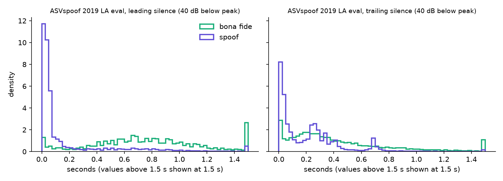
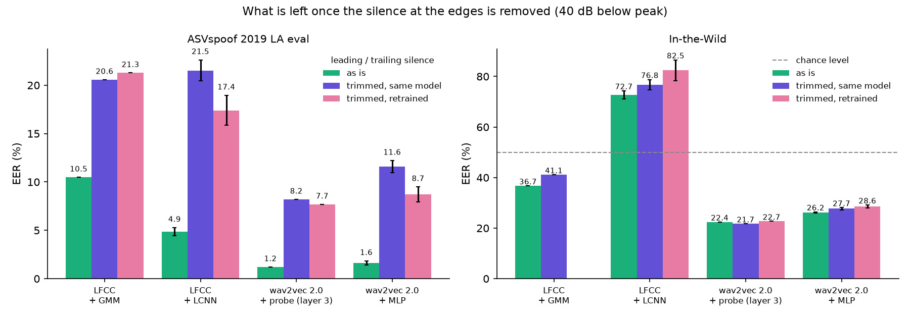
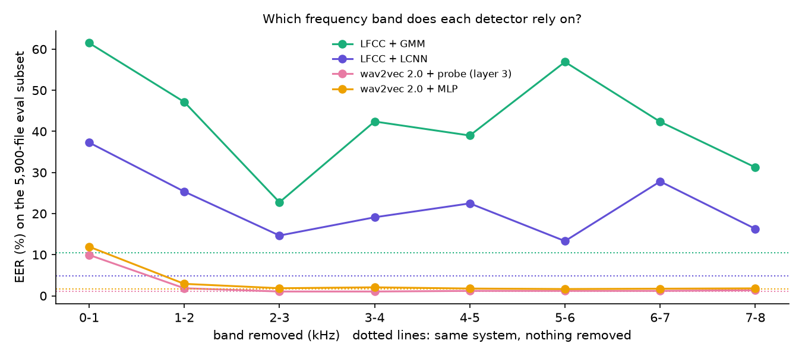

# Milestone 4: are the detectors listening to the voice?

Milestones 2 and 3 gave numbers that looked too good on ASVspoof (1.2 % EER) and fell
apart on real-world deepfakes (22 %). Two checks here: the silence at the edges of the
files, and which frequency bands each detector depends on.

## 1. Silence alone is a detector

ASVspoof 2019 LA is known to leak the label through the leading and trailing silence
(Müller et al., 2021, arXiv:2106.12914). I measured it on all 121,461 files: a frame is
speech when its RMS energy is within N dB of the loudest frame of the same file (20 ms
frames, 10 ms hop), and only the edges are trimmed. N = 30, 40 and 50 dB, so that no
conclusion depends on one setting.



Median leading silence on eval (40 dB): **0.74 s for bona fide, 0.04 s for spoofs.**

A logistic regression trained on train, that never sees the speech, only the log of the
two silence lengths:

| Features | 30 dB | 40 dB | 50 dB |
|---|---|---|---|
| leading + trailing silence | **18.2 %** | **19.6 %** | 45.3 % |
| file duration only (control) | 42.0 % | 42.0 % | 42.0 % |
| speech duration only (control) | 40.7 % | 44.1 % | 43.7 % |

(eval EER, all attacks pooled; 50 % is chance; 95 % intervals in `results/m4/silence_only.csv`, all
within ±0.73 point.)

A detector that hears no word reaches 19.6 % EER. The durations stay near chance, so it is
the silence itself that carries the label, not file length. At 50 dB the leak disappears:
real recordings have room noise above that level, so their "silence" no longer counts as
silence. The shortcut is the difference between the **digital silence** of the generators
and the **room silence** of real recordings.

## 2. What is left without it

Same four systems as milestone 3. Silence removed at 40 dB, from the audio before the
features (wav2vec 2.0, LCNN), or by dropping the matching LFCC frames (GMM). Two ways:
the original model scored on trimmed audio, and a model retrained and re-selected on
trimmed audio.



| System | eval, as is | eval, trimmed (same model) | eval, trimmed (retrained) | In-the-Wild, as is | In-the-Wild, trimmed (same) | In-the-Wild, trimmed (retrained) |
|---|---|---|---|---|---|---|
| LFCC + GMM | 10.48 | 20.57 | 21.28 | 36.72 | 41.11 | not run |
| LFCC + LCNN (3 seeds) | 4.86 ± 0.42 | 21.53 ± 1.09 | 17.40 ± 1.55 | 72.70 ± 1.64 | 76.78 ± 2.01 | 82.46 ± 4.11 |
| wav2vec 2.0 + probe (layer 3) | 1.21 | 8.20 | 7.68 | 22.44 | 21.71 | 22.71 |
| wav2vec 2.0 + MLP (3 seeds) | 1.64 ± 0.20 | 11.59 ± 0.63 | 8.72 ± 0.78 | 26.18 ± 0.24 | 27.68 ± 0.42 | 28.58 ± 0.58 |

Single-run intervals and per-seed values: `results/m4/silence.csv`.

What I take from it:

- **Every system used the silence**, wav2vec 2.0 included. Without it the probe goes from
  1.21 to 8.20 % (×6.8), the MLP from 1.64 to 11.59 % (×7.1), the GMM doubles.
- **Retraining on trimmed audio recovers only a little** (probe 7.68 %, MLP 8.72 %, LCNN
  17.40 %). The models were not just surprised by a new input: without the silence, the
  task is genuinely harder. **About 8 % is a more honest figure for wav2vec 2.0 on ASVspoof
  2019 LA than 1.2 %.**
- **In-the-Wild barely moves** (probe 22.4 → 21.7 %). That fits: this real-world set has no
  such leak, so removing the silence takes nothing away there. It also means the gap between
  ASVspoof and In-the-Wild shrinks from ×18.5 (22.44 / 1.21) to ×2.6 (21.71 / 8.20) once the shortcut is gone.
- **The LCNN's inverted ranking on In-the-Wild has nothing to do with silence**: trimming
  makes it worse (72.7 → 76.8 %, 82.5 % retrained). My milestone 3 guess was half right:
  silence is part of what it learned on ASVspoof, but not what breaks it on real recordings.

The LCNN was retrained on Kaggle for this milestone (milestone 3 deleted the weights). On
eval it gives 4.86 ± 0.42 % against 5.63 ± 0.68 % in milestone 3: GPU training is not
bit-exact, and the two sets of three seeds overlap.

## 3. Which band does each detector need?

On a stratified eval subset (2,000 bona fide + 300 per attack, 5,900 files, fixed seed,
list in `results/m4/band_subset_eval.csv`), each 1 kHz band is removed in turn (STFT, bins
set to zero, inverse STFT; same masked audio for every system).



| System | untouched | 0–1 kHz removed | 1–2 kHz | 2–3 kHz | 3–4 kHz | 4–5 kHz | 5–6 kHz | 6–7 kHz | 7–8 kHz |
|---|---|---|---|---|---|---|---|---|---|
| LFCC + GMM | 10.41 | 61.51 | 47.15 | 22.76 | 42.41 | 39.00 | 56.90 | 42.34 | 31.25 |
| LFCC + LCNN | 4.85 | 37.29 | 25.35 | 14.67 | 19.11 | 22.49 | 13.32 | 27.82 | 16.30 |
| wav2vec 2.0 + probe | 1.10 | **9.95** | 1.85 | 1.05 | 1.05 | 1.20 | 1.20 | 1.20 | 1.35 |
| wav2vec 2.0 + MLP | 1.64 | **11.95** | 2.92 | 1.85 | 2.07 | 1.77 | 1.65 | 1.73 | 1.81 |

- **wav2vec 2.0 depends on one band: 0–1 kHz.** Removing it multiplies the EER by 9.0 for the probe and 7.3 for the MLP;
  removing any band above 2 kHz changes nothing measurable. 0–1 kHz is where the voice
  fundamental and the first formant live, and also where room hum and low-frequency noise
  sit, so this does not tell yet whether the model hears the voice or the background there.
- **The LFCC systems break whatever band is removed**, the GMM up to 61.5 % (worse than
  chance). This needs care: a cepstral coefficient mixes all bands, so removing one band
  shifts every coefficient. For LFCC, this experiment measures fragility to a change of
  spectrum as much as reliance on a band. I would not read the LFCC curve as "the GMM uses
  5–6 kHz".

## Limits

- Silence trimming uses one energy rule. It catches the edges only; pauses inside the
  speech are kept.
- The band study uses a 5,900-file subset and one occlusion type (hard zeroing). The first
  and last 24 ms of each file are slightly altered by the STFT padding (measured, see
  `src/adg/bands.py`).
- The 0–1 kHz result raises a question I have not answered: voice or background?

## Reproducing

```bash
python scripts/silence_stats.py
python scripts/silence_shortcut.py
python scripts/trimmed_gmm.py
# Kaggle: kaggle/milestone4.ipynb (input awsaf49/asvpoof-2019-dataset), outputs into features/w2v2_m4 and results/m4
python scripts/m4_ssl.py
python scripts/evaluate_m4.py
```
