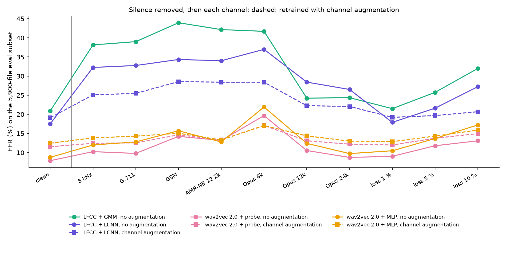

# Milestone 5: what survives a phone line?

Voice fraud goes through a phone call or a VoIP app, not through clean 16 kHz studio
files. Here every system of milestone 4 (all trained **without** the leading and trailing
silence, so the silence shortcut does not mix with the channel effect) is tested through
ten simulated channels, then retrained with channel augmentation.

## Channels

All in `src/adg/channel.py`, each tested in `tests/test_channel.py`:

| Name | What it does |
|---|---|
| 8 kHz | 16 → 8 → 16 kHz: telephone bandwidth, nothing above 4 kHz |
| G.711 | 8 kHz + G.711 µ-law, the classic fixed-line codec. Written by hand; **identical to ffmpeg's encoder on all 65,536 16-bit inputs** |
| GSM | GSM 06.10 full rate (2G mobile), through ffmpeg (libgsm) |
| AMR-NB 12.2k | AMR narrowband at 12.2 kbit/s (2G/3G mobile), through ffmpeg (opencore) |
| Opus 6k / 12k / 24k | Opus at 6, 12 and 24 kbit/s (VoIP apps), through ffmpeg (libopus) |
| loss 1 / 5 / 10 % | 20 ms frames set to zero at random, no concealment |

The G.711 encoder took two attempts. The first used the classic Sun bit tricks on 16-bit
samples and differed from ffmpeg by one code on 851 of the 65,536 inputs, all at decision
boundaries. G.711 µ-law is defined on 14-bit samples; building the table the way ffmpeg
does fixed it.

Test set: the 5,900-file stratified eval subset of milestone 4 (2,000 bona fide + 300 per
attack), silence trimmed, then through each channel. Augmentation: every training and dev
file once clean and once through one channel picked at random per file (deterministic,
about a tenth of the files per channel); model selection on the augmented dev set.

## Results



EER (%), mean over 3 seeds for the LCNN and the MLP (per-run intervals and standard
deviations in `results/m5/channels.csv`):

| System | Training | clean | 8 kHz | G.711 | GSM | AMR-NB | Opus 6k | Opus 12k | Opus 24k | loss 1 % | loss 5 % | loss 10 % | mean of the 10 |
|---|---|---|---|---|---|---|---|---|---|---|---|---|---|
| LFCC + GMM | no augmentation | 20.91 | 38.15 | 39.00 | 43.95 | 42.15 | 41.70 | 24.24 | 24.35 | 21.49 | 25.75 | 32.00 | 33.28 |
| LFCC + LCNN | no augmentation | 17.52 | 32.27 | 32.76 | 34.34 | 34.01 | 36.99 | 28.43 | 26.50 | 17.91 | 21.61 | 27.23 | 29.21 |
| LFCC + LCNN | augmentation | 19.12 | 25.09 | 25.49 | 28.55 | 28.41 | 28.40 | 22.27 | 22.07 | 19.22 | 19.68 | 20.68 | **23.99** |
| wav2vec 2.0 + probe | no augmentation | **7.90** | 10.25 | 9.80 | 14.25 | 13.19 | 19.66 | 10.54 | 8.75 | 9.04 | 11.80 | 13.09 | **12.04** |
| wav2vec 2.0 + probe | augmentation | 11.54 | 12.44 | 12.54 | 14.65 | 13.35 | 17.10 | 13.10 | 12.20 | 12.00 | 13.76 | 14.96 | 13.61 |
| wav2vec 2.0 + MLP | no augmentation | 8.76 | 12.00 | 12.80 | 15.71 | 12.78 | 21.92 | 12.41 | 9.75 | 10.48 | 13.68 | 17.24 | 13.88 |
| wav2vec 2.0 + MLP | augmentation | 12.45 | 13.86 | 14.30 | 15.07 | 13.32 | 17.07 | 14.38 | 13.01 | 12.86 | 14.32 | 15.90 | 14.41 |

What I take from it:

- **The LFCC systems collapse as soon as the band is cut to 8 kHz** (GMM 20.9 → 38.2 %,
  LCNN 17.5 → 32.3 %), and stay there for every narrowband codec. This fits milestone 4,
  where they broke whichever band was removed: their decision uses the whole 0–8 kHz
  spectrum, and half of it is gone on a phone line.
- **wav2vec 2.0 degrades much less.** The telephone band alone costs the probe 2.4 points
  (7.9 → 10.3 %) and G.711 on top of it nothing more. Also consistent with milestone 4: the
  probe relies on 0–1 kHz, which a phone line keeps.
- **Low-bitrate codecs are what hurts it**: Opus 6k is the worst channel for both wav2vec
  2.0 systems (19.7 and 21.9 %), then GSM. A codec that resynthesises speech from a
  parametric model may erase, or imitate, exactly the cues of a vocoder. That is a
  hypothesis; I have not tested it.
- **Augmentation helps the LCNN** (mean over the channels 29.2 → 24.0 %, at a cost of 1.6
  points on clean audio).
- **For wav2vec 2.0, augmentation is not a net gain.** It flattens the curve (Opus 6k
  19.7 → 17.1 % for the probe) but raises the floor: clean 7.9 → 11.5 %, mean over the
  channels 12.0 → 13.6 %. With a frozen model and a linear or small head, mixing clean and
  degraded audio seems to blur the boundary rather than teach channel invariance. With one
  degraded copy per file and one way of mixing, I cannot say whether a different recipe
  (fine-tuning, more copies) would change that.

So hypothesis H4 of my spec holds for the LFCC systems (strong degradation, partly
recovered by augmentation) and only half for wav2vec 2.0 (moderate degradation, no gain
from this augmentation).

## What I could not do

**Real telephone channels (ASVspoof 2021 LA) are missing.** The audio is on Zenodo, but
its labels and channel metadata (`LA-keys-full.tar.gz`) are only distributed by
asvspoof.org, which answered HTTP 503 from my laptop and from Kaggle during this
milestone. The notebook skips that part on purpose when the keys cannot be fetched, so
the simulated channels above are all I have. The code is in place
(`scripts/download_asvspoof2021.py`, `src/adg/asvspoof2021.py`) if the site comes back.

## Limits

- The channels are simulations: real networks add jitter buffers, concealment of lost
  packets, transcoding between codecs and noise. Packet loss here is the crudest case,
  zeros without concealment.
- On Kaggle no single ffmpeg build had every codec: GSM and Opus went through the Ubuntu
  build, AMR-NB through the imageio-ffmpeg one. Each codec always uses the same binary, so
  the runs are reproducible, but another build could give slightly different audio.
- One channel per augmented file, one random draw, one augmentation recipe.

## Reproducing

```bash
# Kaggle: kaggle/milestone5.ipynb (input awsaf49/asvpoof-2019-dataset), outputs into features/w2v2_m5 and results/m5
python scripts/m5_ssl.py
python scripts/evaluate_m5.py
```
